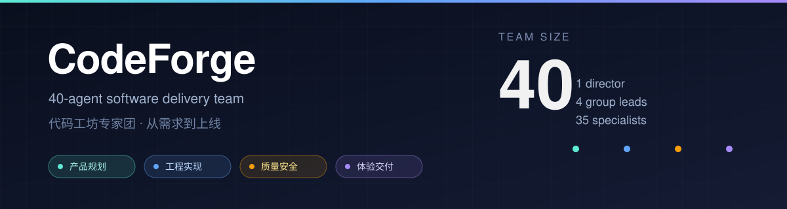

<div align="center">



# CodeForge Team

**One sentence in. A 40-person software delivery team out.**

Four groups — Product, Engineering, Quality & Security, Experience & Delivery — take an idea from requirement to a reviewed, documented, shippable product.

[](LICENSE)
[](references/team.json)
[](SKILL.md)

[中文](README.md) · [Install](docs/INSTALL.md) · [Architecture](docs/ARCHITECTURE.md)

</div>

> **If you think playing with Agents means you never have to worry about your PC's performance, try this Agent team — and tell them to go full throttle!**
>
> **你觉得自己玩 Agent 就可以不要考虑 PC 性能消耗的话，就来试试这个 Agent 团吧！记得叫他们火力全开！**

---

## The idea

A single agent tends to do everything itself: write the spec, write the code, and then declare the code correct. Long sessions erode constraints, and "it ran once" gets promoted to "it is verified".

CodeForge changes the **organization**, not the model:

- Requests go to one lead. The lead dispatches only to four group leads. Group leads dispatch to specialists. No skipping levels, no private contract changes between groups.
- Each stage has an exit condition. The quality gate must pass before delivery.
- Every delivery carries evidence: commands, logs, test results, API responses, screenshots, or file paths. A "done" without evidence is rejected.

It is not a model and not a toolset. It is a portable **delivery protocol** written as a `SKILL.md` skill.

## Quick start

Install it as a DSH plugin:

```powershell
dsh plugin --profile web add codeforge-team
```

Use `--profile desktop` for the desktop app, or install straight from GitHub:

```powershell
dsh plugin --profile web add github:lilinshuei/codeforge-team
```

Prefer a plain skill copy? DeepSeek Harness discovers `skills/<name>/SKILL.md` (non-recursive):

```bash
git clone https://github.com/lilinshuei/codeforge-team.git
mkdir -p ~/.dsh/skills
cp -r codeforge-team ~/.dsh/skills/
```

Project-scoped install: `<project>/.dsh/skills/codeforge-team/`.

Then start a session and say:

> Use CodeForge Team for a self-check: report the roster, the current tier, and the next step.

Or hand over real work:

> Use CodeForge Team to add CSV export to the admin dashboard, full workflow.

## How it runs

Six stages with gates: intake → plan → build → quality gate → experience delivery → final review. Any stage can send work back, but only with a reason and a list of missing evidence.

Three tiers are chosen automatically by a six-dimension score (0–18): lite (2–4 specialists), standard (6–10), full (all 40 in the plan, executed in waves). Escalation is one-way and does not wait for confirmation.

Full tier means **40 people in the plan**, not 40 concurrent threads. Concurrency still obeys the host.

## What is in the box

- `SKILL.md` — routing, tier selection, dispatch rules.
- `references/team.json` — single source of truth: org chart, stages, 40 role records, policies.
- `references/protocol/` — orchestration, intake scoring, handoff, runtime modes.
- `references/agents/` — 40 role prompts.
- `docs/` — installation and architecture notes.

No scripts, no dependencies, no network calls, no telemetry. It only shapes how the host agent organizes work.

## Compatibility

| Host | Mode | Where to put it |
|---|---|---|
| DeepSeek Harness | Skill / native sub-agents | `~/.dsh/skills/` or `<project>/.dsh/skills/` |
| Qoder | Skill + Agent tool | the host's user or project skill directory |
| Claude Code | Skill + Task subagents | the host's skill directory |
| Codex CLI | subagents / role-play | the host's agents directory, or read `SKILL.md` directly |
| Any Markdown-capable model | single-model role-play | feed `SKILL.md` plus `references/` |

Hosts without subagents degrade to sequential role-play. Stages, gates and evidence requirements still apply; the team does not pretend to run in parallel.

## License

[MIT](LICENSE) © 2026 lilinshuei

Not affiliated with DeepSeek. DeepSeek Harness is a project of its respective owners.
