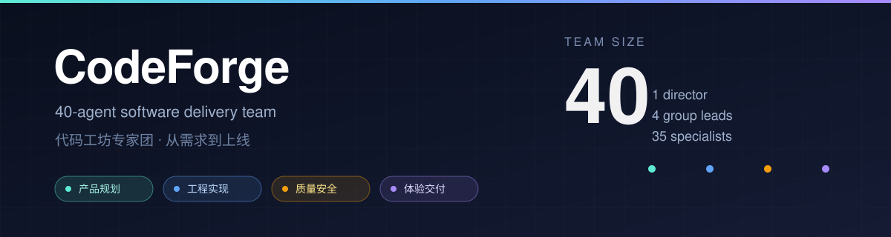

<div align="center">



# 代码工坊专家团 · CodeForge

**一句话需求，交给一支 40 人的软件交付团队。**

从需求到上线，分四组推进：产品规划、工程实现、质量安全、体验交付。

[](LICENSE)
[](references/team.json)
[](SKILL.md)
[](https://github.com/topics/dsh-plugin)
[](#这个仓库里有什么)

[30 秒上手](#30-秒上手) · [团队名册](#团队名册) · [工作方式](#工作方式) · [English](README.en.md)

</div>

> **你觉得自己玩 Agent 就可以不要考虑 PC 性能消耗的话，就来试试这个 Agent 团吧！记得叫他们火力全开！**
>
> **If you think playing with Agents means you never have to worry about your PC's performance, try this Agent team — and tell them to go full throttle!**

---

## 为什么需要一支团队

单个 Agent 的老毛病是「什么都自己干」：自己写需求、自己写代码、自己说没问题。上下文一长，它会忘记约束；要交付时，它又会把「跑过一次」当成「验证过」。

CodeForge 换了一个思路：**不换模型，换组织。**

- 需求只进主理人，主理人只派给四位组长，组长再拆给组员——不许越级，不许组与组私下改契约。
- 每个阶段有明确的出门条件，质量门禁不过就不许进交付。
- 交付必须带证据：命令、日志、测试结果、接口返回、截图或文件路径。没有证据的「完成」会被打回。

它不是另一个模型，也不是一套工具。它是一份可移植的**组织协议**。

## 30 秒上手

### 1. 安装

**方式 A：作为 DSH 插件安装（推荐，一条命令）**

```powershell
dsh plugin --profile web add codeforge-team
```

桌面端把 `web` 换成 `desktop`。装完重启 DSH，新会话即可使用。也可以直接从 GitHub 安装：

```powershell
dsh plugin --profile web add github:lilinshuei/codeforge-team
```

**方式 B：手动复制 Skill**

DeepSeek Harness 会扫描 `skills/<name>/SKILL.md`，不递归。把整个目录放进技能根目录即可。

```bash
git clone https://github.com/lilinshuei/codeforge-team.git
mkdir -p ~/.dsh/skills
cp -r codeforge-team ~/.dsh/skills/
```

Windows PowerShell：

```powershell
git clone https://github.com/lilinshuei/codeforge-team.git
New-Item -ItemType Directory -Force "$HOME\.dsh\skills" | Out-Null
Copy-Item -Recurse -Force .\codeforge-team "$HOME\.dsh\skills\"
```

最终路径应为 `~/.dsh/skills/codeforge-team/SKILL.md`。只想在单个项目里用，就放到 `<项目根>/.dsh/skills/codeforge-team/`。

### 2. 自检

新开一个会话，说：

> 用代码工坊专家团做个自检：报编制、档位、下一步。

它应该报出 40 人组织、四个组长、判档逻辑，然后等一个真实任务。

### 3. 开工

```text
用代码工坊专家团，把登录页的报错修一下。                    # 会判成精简档
用代码工坊专家团，给现有后台加一个订单导出，走完整流程。      # 会判成标准档
用代码工坊专家团，全量启用，从 0 做一个会员小程序，四组都要有产出。  # 全量档
```

不需要先选档位。主理人会先判档，广播一行编队，然后直接开工：

```text
【编队】标准档 · 11 人 · 3 波 · 判档 8/18（多模块 + 集成验证）
【波次】plan: 产品组 4 人 → build: 工程组 5 人 → gate: 质量组 2 人
【升级】发现 ≥3 组并行或生产风险会自动升档；要立刻全量说“全量启用”
```

## 团队名册

主理人 1 人，四个组共 35 位专家。

<details>
<summary><b>展开全部 40 个角色</b></summary>

| 角色 ID | 姓名 | 岗位 | 组 |
|---|---|---|---|
| `codeforge-team-lead` | 沈砺 | 项目开发部门主管 | 主理人 |
| `product-planning-lead` | 顾砚 | 产品规划组长 | 产品规划组 |
| `engineering-lead` | 程启 | 工程实现组长 | 工程实现组 |
| `quality-security-lead` | 卫衡 | 质量安全组长 | 质量安全组 |
| `experience-delivery-lead` | 颜作 | 体验交付组长 | 体验交付组 |
| `requirement-analyst` | 闻需 | 需求分析师 | 产品规划组 |
| `product-manager` | 明策 | 产品经理 | 产品规划组 |
| `ux-researcher` | 察言 | 用户研究员 | 产品规划组 |
| `interaction-designer` | 织径 | 交互设计师 | 产品规划组 |
| `visual-designer` | 绘真 | 视觉设计师 | 产品规划组 |
| `market-researcher` | 观澜 | 市场与竞品研究员 | 产品规划组 |
| `product-analyst` | 数衡 | 产品数据分析师 | 产品规划组 |
| `monetization-strategist` | 谋商 | 商业化策划 | 产品规划组 |
| `agile-coach` | 齐程 | 敏捷交付教练 | 产品规划组 |
| `solution-architect` | 承重 | 系统架构师 | 工程实现组 |
| `frontend-engineer` | 纪页 | 前端工程师 | 工程实现组 |
| `backend-engineer` | 镇岳 | 后端工程师 | 工程实现组 |
| `fullstack-prototyper` | 速成 | 全栈原型工程师 | 工程实现组 |
| `database-engineer` | 存真 | 数据库工程师 | 工程实现组 |
| `api-integrator` | 连城 | API 与集成工程师 | 工程实现组 |
| `crossplatform-engineer` | 通端 | 跨端与小程序工程师 | 工程实现组 |
| `website-builder` | 立站 | 网站搭建工程师 | 工程实现组 |
| `devops-engineer` | 布阵 | DevOps 与部署工程师 | 工程实现组 |
| `code-reviewer` | 审微 | 代码审查员 | 质量安全组 |
| `refactoring-engineer` | 砺旧 | 重构与代码修改工程师 | 质量安全组 |
| `qa-engineer` | 验真 | 测试工程师 | 质量安全组 |
| `test-automation-engineer` | 机验 | 自动化测试工程师 | 质量安全组 |
| `security-code-auditor` | 守码 | 安全代码审计师 | 质量安全组 |
| `vulnerability-pentester` | 破阵 | 漏洞排查与渗透测试师 | 质量安全组 |
| `performance-engineer` | 迅流 | 性能优化工程师 | 质量安全组 |
| `accessibility-reviewer` | 通达 | 可访问性与兼容性审查员 | 质量安全组 |
| `release-gatekeeper` | 守关 | 发布质量守门员 | 质量安全组 |
| `ui-implementation-engineer` | 落墨 | UI 视觉实现工程师 | 体验交付组 |
| `creative-motion-engineer` | 流光 | 动效与编码视觉工程师 | 体验交付组 |
| `data-viz-engineer` | 图观 | 数据可视化工程师 | 体验交付组 |
| `technical-writer` | 笔正 | 技术文档工程师 | 体验交付组 |
| `delivery-manager` | 定盘 | 交付与上线经理 | 体验交付组 |
| `seo-growth-engineer` | 扬帆 | SEO 与增长工程师 | 体验交付组 |
| `presentation-designer` | 呈见 | 演示与汇报设计师 | 体验交付组 |
| `customer-success-engineer` | 护行 | 客户成功与支持工程师 | 体验交付组 |

角色姓名是虚构的，只作为稳定的引用标签；每个角色的完整提示词在 [`references/agents/`](references/agents/)。

</details>

## 工作方式

### 六阶段，每阶段有门禁

| 阶段 | 负责人 | 产物 | 出门条件 |
|---|---|---|---|
| 受理分级 | 主理人 | 任务卡 | 目标可观察、范围有边界、风险已分级 |
| 立项方案 | 产品规划组长 | PRD、方案、里程碑、验收清单 | 每条需求都有验收口径 |
| 架构实现 | 工程实现组长 | 架构决策、可运行代码、迁移与部署说明 | 真实入口可启动，关键路径跑通 |
| 质量门禁 | 质量安全组长 | 审查、测试、安全、性能报告与放行结论 | 高危清零或有书面豁免，测试有证据 |
| 体验交付 | 体验交付组长 | UI、动效、文档、上线与演示物料 | 用户可操作，文档能照着做 |
| 终验复盘 | 主理人 | 交付包、证据链、遗留风险 | 验收清单逐项有结论 |

任何阶段都可以打回上一阶段，但必须写清「打回原因 + 需要补什么证据」。

### 三档编队，按任务自动判

六维评分，满分 18：范围、并行工作流、交付物、风险、不确定性、验证成本。

| 总分 | 档位 | 编队 |
|---|---|---|
| 0~5 | 精简档 | 主理人 1 + 组长 1 + 专家 2~4 |
| 6~11 | 标准档 | 主理人 1 + 组长 2~3 + 专家 6~10 |
| 12~18 | 全量档 | 40 人全部进计划，分波次推进 |

判档不是一次性决定：执行中发现 ≥3 个组有真实交付物、任务卡 ≥9 张、或出现生产与安全要求，会自动升一档并广播。用户点名档位时，以用户为准。

**全量档 ≠ 40 个并发线程。** 它是 40 人全部进计划、全部有任务卡，按 `plan → build → gate → deliver` 分波，并发上限仍服从宿主。

### 任务卡与交付包

派活必须填全：目标、输入、约束、交付物、证据、验收、风险、截止。缺一项，接活方退回补齐，不许靠猜开工。

收活必须带：产物路径、证据清单、逐条验收结果、遗留风险、下一棒建议。

## 设计原则

1. **分层汇报，不越级。** 主管只派组长，组长只派组员；跨组依赖经主管中转。
2. **证据优先。** 「跑过一次」不算验证；命令、日志、测试、截图才算。
3. **按需扩编。** 小修不拉 40 人；但升级不需要用户再确认。
4. **契约稳定。** 任务卡与交付包格式跨宿主、跨波次保持一致。
5. **协议可移植。** 组织协议与平台适配器分离，换宿主不改流程。

## 仓库结构

```text
codeforge-team/
├── SKILL.md                    # 技能入口：何时用、怎么判档、怎么调度
├── references/
│   ├── team.json               # 唯一事实源：组织、阶段、40 人元数据、策略
│   ├── ONBOARDING.md           # 30 秒上手与常见误解
│   ├── protocol/
│   │   ├── ORCHESTRATION.md    # 指挥链、六阶段、任务卡、交付包
│   │   ├── INTAKE.md           # 六维判档、覆盖规则、升级条件
│   │   ├── HANDOFF.md          # 交接与打回格式
│   │   └── RUNTIME-MODES.md    # 原生 / Skill / 角色扮演三种跑法
│   └── agents/                 # 40 份角色提示词
├── docs/
│   ├── INSTALL.md              # 各宿主安装与卸载
│   └── ARCHITECTURE.md         # 组织设计与协议说明
├── examples/
│   └── demo.md                 # 一次完整交付的示意
└── .github/workflows/validate.yml
```

## 兼容性

本仓库是 **Skill（指令层）**，不是运行时插件：不注册工具、不改宿主、不发网络请求。

| 宿主 | 推荐模式 | 放置位置 |
|---|---|---|
| DeepSeek Harness | Skill 驱动 / 原生子 Agent | `~/.dsh/skills/` 或 `<项目>/.dsh/skills/` |
| Qoder | Skill + Agent 工具 | 宿主的用户级或项目级技能目录 |
| Claude Code | Skill + Task 子代理 | 宿主技能目录 |
| Codex CLI | 子 Agent / 角色扮演 | 宿主 agents 目录，或直接读 `SKILL.md` |
| 任意支持 Markdown 的模型 | 单模型角色扮演 | 把 `SKILL.md` 与 `references/` 一起喂入 |

没有原生子 Agent 的宿主会退化为串行角色扮演——阶段、门禁、证据链仍然保留，但不会假装并行。

## 常见问题

**会一次拉起 40 个 Agent 吗？**
不会。默认按任务判档。想全量，明确说「全量启用」或「40 人全开」。

**它会直接改我的代码吗？**
会写文件，但只能在任务卡的 `constraints` 内。建议在独立分支上跑，小步提交，交付后由你 review。流程约束不是沙箱。

**需要额外的 API Key 吗？**
不需要。它使用宿主已经配置好的模型与工具。

**为什么打上 `dsh-plugin` 标签？**
为了在 DeepSeek Harness 生态里被检索到。严格说它是 Skill，不是插件；如果你的市场只收录 `apply(ctx)` 插件，请以 Skill 方式安装。

**能改成 20 人、或加自己的角色吗？**
可以。改 `references/team.json`，新增 `references/agents/<id>.md`，保持 `id`、`reports_to`、`group` 一致即可。CI 会检查一致性。

**费用怎么控制？**
用精简档；把「全量」留给真正需要多组并行的任务。全量档的并发也受宿主限制。

## 参与贡献

欢迎提角色改进、协议修正和真实使用反馈。请先读 [CONTRIBUTING.md](docs/CONTRIBUTING.md)。

如果这个团队帮你交付了东西，欢迎点一个 Star。

## 许可

[MIT](LICENSE) © 2026 lilinshuei

本项目与 DeepSeek 官方无隶属关系。DeepSeek Harness 是其各自权利人的商标或项目名。
